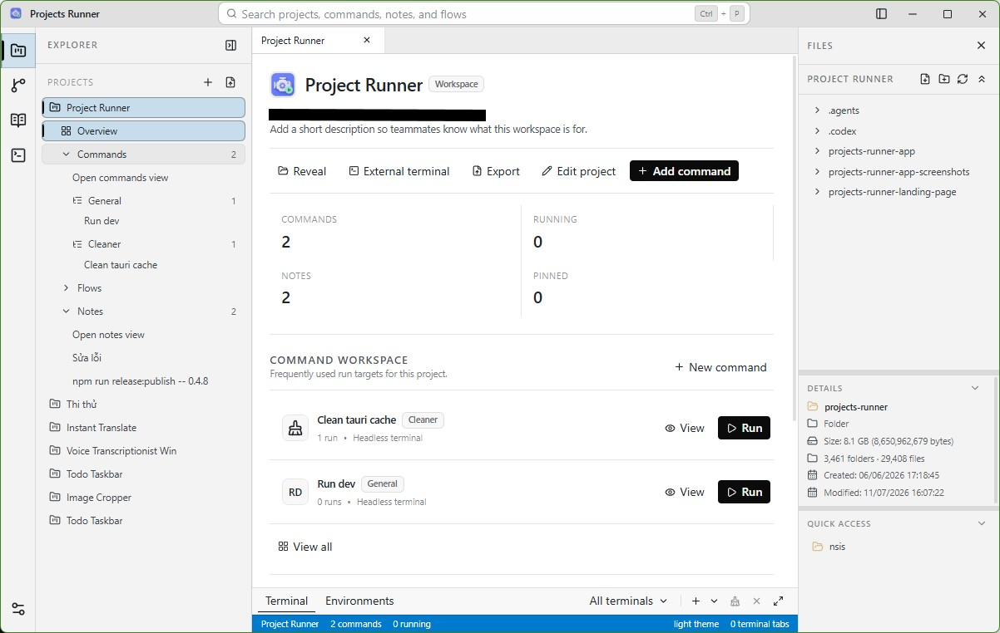
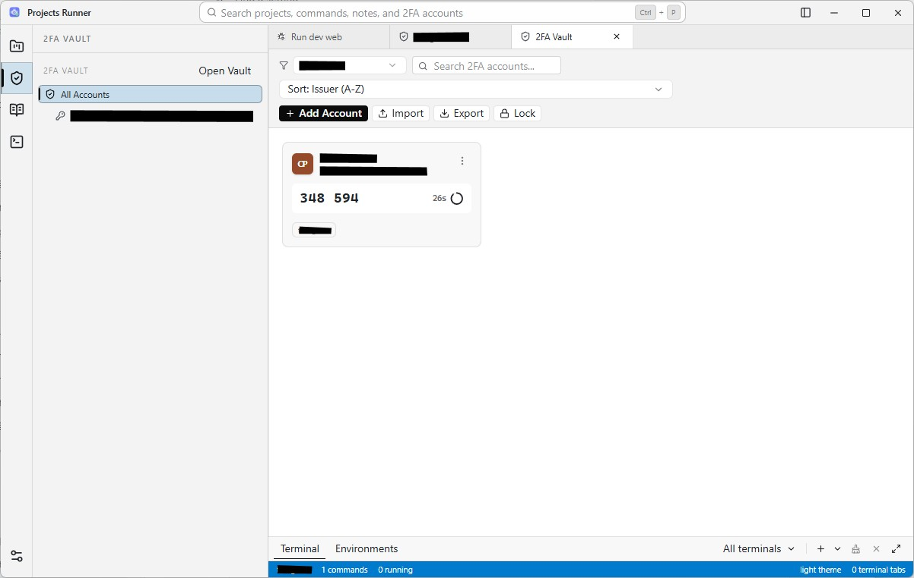
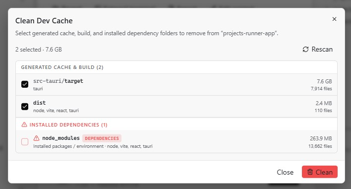
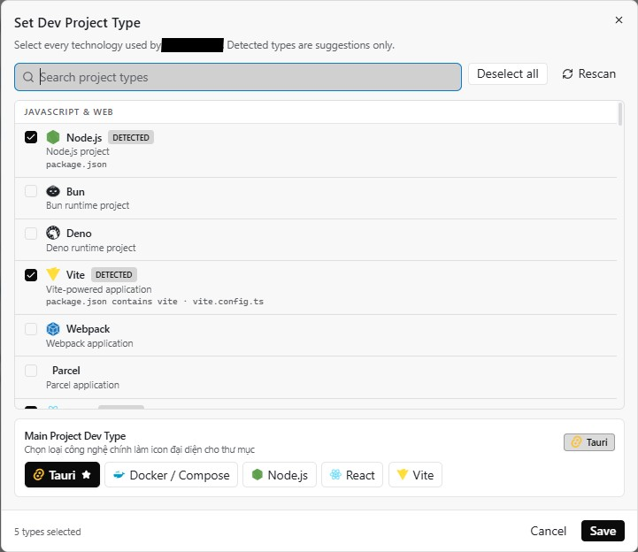
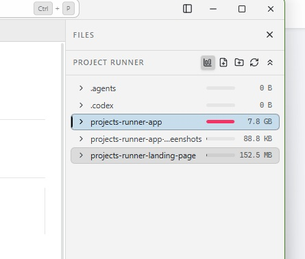

# Projects Runner

Your project commands, terminals, notes, and 2FA codes in one desktop workspace.
Save your everyday commands once. Run them whenever you need them.

**[Download the latest release](https://github.com/ocampoje17/projects-runner-app/releases/latest)** · [Website](https://projects-runner.laychu.com) · [Report an issue](https://github.com/ocampoje17/projects-runner-app/issues)



## What you can do

- **Organize projects** — keep folders, command groups, and notes together.
- **Run saved commands** — launch dev servers, builds, tests, and scripts without retyping.
- **Choose your terminal** — run in the background, use interactive terminal tabs, or open an external terminal.
- **Follow each run** — watch output, stop processes, and rerun commands.
- **Keep 2FA close** — manage project-linked TOTP accounts in an encrypted vault, scan QR codes, and export encrypted backups.
- **Free up disk space** — inspect project storage and choose which dev caches, build output, or dependencies to clean.
- **Share your setup** — export and import projects as `.prd` files.
- **Sync between computers** — manually exchange projects, commands, notes, avatars, and app preferences through a folder on a USB drive or external disk.

Your projects, commands, and notes stay on your machine. No cloud account needed.

## Get started

1. **[Download](https://github.com/ocampoje17/projects-runner-app/releases/latest)** and install the package for your system.
2. **Add a project** by choosing its local folder.
3. **Save a command**, choose its run mode, and press **Run**.

| Windows | Linux | macOS |
| --- | --- | --- |
| `.exe` installer | `.AppImage` or `.deb` | `.dmg` for Apple Silicon |

Shared commands may need adjustments for a different operating system or shell.

## Sync through an external drive

1. Open **Settings → Data Sync**, choose a folder on the drive, and select the data groups to sync. All five groups are selected by default.
2. Click the sync icon beside the app name, or **Sync now** in settings.
3. On another computer, select the same folder and sync. Review any project matches or conflicting versions.
4. Before moving the drive to another computer, sync your latest changes. When reconnecting it, click sync again.

Each computer keeps its own working database and project folder paths. The drive contains a versioned `.projects-runner-sync` repository; keep that folder intact when moving or backing it up. If the drive letter changes, choose the folder again in settings.

Turning off a data group pauses its synchronization without removing existing data. The sync folder, group selections, and last successful sync time are remembered locally for each repository. 2FA vaults, source files, terminal sessions, logs, run counts, and window layouts stay on each computer.

## A closer look

| Built-in 2FA vault | Clean dev cache |
| --- | --- |
|  |  |

| Project tech stack | Storage at a glance |
| --- | --- |
|  |  |

## Run from source

Requires Node.js 20+, npm, Rust, and the [Tauri prerequisites](https://v2.tauri.app/start/prerequisites/) for your system.

```bash
npm install
npm run tauri dev
```

Create a desktop build with `npm run release:build`.

Built with Tauri 2, React, TypeScript, and Tailwind CSS.

[2FA vault guide](docs/twofa-vault.md) · [Platform notes](docs/cross-platform-notes.md) · [Release guide](docs/releasing.md)
